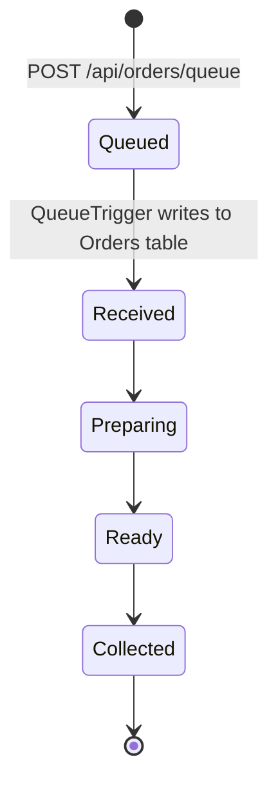
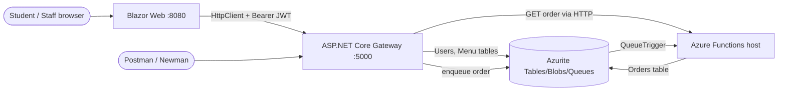

# 🍦 SwirlStop — Capstone Guide: Parts 2 & 3 (Integrated with Render & CI/CD)

> A mini-POE to wrap up the syllabus. You will build a frozen yogurt shop platform that mirrors the real POE requirements (queues, Docker Compose, Docker Hub, API gateway, JWT, VPS, CI/CD) and adds a **Blazor** frontend.

> [!WARNING]
> ## 💸 DO NOT PAY FOR ANYTHING
> **No group should pay for any service, subscription, domain, or cloud resource for this project. Nobody will be reimbursed.**
> - Use only free tiers, free credits, or hardware you already own (Linux box, Raspberry Pi, old laptop).
> - Cloud free tiers expire, have limits, and can bill you silently. **Set a billing alert before you create anything** and **delete/terminate every resource as soon as your video is marked**.
> - If a service asks for a credit card and you are not 100% sure it will stay free, **stop and ask your lecturer**.
> - Marks are never awarded for spending money. A well-documented project running on a free option scores exactly the same.

---

## Table of Contents

1. [The Scenario](#1-the-scenario)
2. [Ground Rules, AI Declaration & Repo Setup](#2-ground-rules-ai-declaration--repo-setup)
3. [Tech Stack & Architecture](#3-tech-stack--architecture)
4. [Part 1 Baseline (assumed complete)](#4-part-1-baseline-assumed-complete)
5. [PART 2 — Queues, Blazor Ordering & Docker Compose](#part-2--queues-blazor-ordering--docker-compose)
6. [PART 3 — Secure Gateway, JWT, Render Deployment & CI/CD](#part-3--secure-gateway-jwt-render-deployment--cicd)
7. [Appendix: Troubleshooting & References](#appendix)

---

## 1. The Scenario

**SwirlStop** is a self-serve frozen yogurt shop next to the campus gym. At 13:00 every day, hundreds of students pile in at once. The current system processes each order synchronously, and the till crashes at peak hour.

You are the dev team that fixes it:

| Part | What you deliver |
| :--- | :--- |
| **Part 2** | Asynchronous orders: customers place orders through a **Blazor** app → orders land on an **Azure Storage Queue** → a **queue-triggered Azure Function** writes them to an **Orders table** and advances their status. Everything runs with one command: `docker compose up`, using images pulled from **Docker Hub**. |
| **Part 3** | A secure **ASP.NET Core Web API gateway** (Swagger, DTOs, JWT, roles), a **staff dashboard** in Blazor, a live **Render (or Linux VPS)** deployment, and (bonus) a **GitHub Actions** pipeline that runs unit tests + Newman against Docker Compose and then deploys. |

### Order lifecycle



---

## 2. Ground Rules, AI Declaration & Repo Setup

### Groups & Git

- Groups of **2–4**. One **public** GitHub repository per group.
- **Minimum 5 commits per student**, spread across the build period (not all on deadline night).
- Use **feature branches** (`feature/queue-producer`, `feature/blazor-tracker`, …) and merge into `main`.
- Use descriptive, feature-based commit messages: `feat: add ProcessOrderQueue function`, not `fix` or `test`.
- Aim for **zero merge conflicts** on `main`. Pull often, commit small, talk before editing shared files.

> [!CAUTION]
> **No GitHub used = −5 marks. Private repo, or GitHub used incorrectly = −5 marks.** Add every group member as a collaborator on day one.

### 🤖 AI Declaration (MANDATORY)

As part of your final submission, you must include a **README** section (or a separate `AI_DECLARATION.md`) detailing your use of AI tools:
- **Which AI tools** you used (e.g., ChatGPT, Copilot, Claude).
- **How you used them** (e.g., debugging, generating boilerplate, writing tests, explaining concepts).
- **What prompts or questions** you asked.
- **How you verified and adapted** the AI-generated code to fit your specific architecture (this is crucial; blind copy-pasting will lose marks).

*Note: You are responsible for the code you submit. If you cannot explain it, you should not submit it.*

### Never commit secrets

- `local.settings.json` must be in `.gitignore` (the Functions template does this).
- The Azurite connection string is a **well-known public dev key**, so it is safe to show in this project. **Anything else is a real secret** (JWT signing key, Docker Hub token, Render Deploy Hook, API keys, SSH key, passwords) and goes in **GitHub Secrets** or a server-side `.env` file that is git-ignored.
- Commit a `.env.example` with placeholder values instead.

### Recommended repository layout

```text
swirlstop/
├── .github/workflows/deploy.yml        # Part 3 CI/CD
├── docs/                               # architecture diagram, screenshots
├── postman/
│   ├── SwirlStop.postman_collection.json
│   └── SwirlStop.local.postman_environment.json
├── src/
│   ├── SwirlStop.Shared/               # models, DTOs, OrderStatusMachine
│   ├── SwirlStop.Functions/            # HTTP + Queue triggers (Parts 1–2)
│   ├── SwirlStop.Gateway/              # ASP.NET Core Web API (Part 3)
│   └── SwirlStop.Web/                  # Blazor Web App (Parts 2–3)
├── tests/
│   └── SwirlStop.Tests/                # xUnit unit tests
├── docker-compose.yml                  # Local dev (images from Docker Hub)
├── docker-compose.ci.yml               # CI-only override: adds build: + published ports
├── docker-compose.prod.yml             # Production stack for Render/VPS
├── .env.example
├── .gitignore
└── README.md
```

**Reference Repository:** You can view the final class project example at: [https://github.com/SMahabeer07/CLDV6212-Final-Class-Project](https://github.com/SMahabeer07/CLDV6212-Final-Class-Project)

---

## 3. Tech Stack & Architecture

| Layer | Technology |
| :--- | :--- |
| Frontend | **Blazor Web App** (Interactive Server render mode), C# |
| Gateway (Part 3) | ASP.NET Core Web API, Swashbuckle, JWT Bearer, BCrypt |
| Background processing | Azure Functions (.NET isolated worker): HTTP + Queue triggers |
| Storage (emulated) | **Azurite**: Tables, Queues, Blobs |
| Containers | Docker, Docker Compose, Docker Hub |
| Testing | xUnit, Postman, **Newman** |
| CI/CD | GitHub Actions |
| Hosting | **Render (In-class focus)**, AWS EC2 / Linux VPS (Optional extension) |

### Architecture (Part 3 final state)



> **Why Blazor Server makes life easy:** components run **on the server**, so `HttpClient` calls to the Functions/Gateway happen server-to-server over the Docker network (`http://gateway:8080`). The browser never talks to them directly, so there are no CORS headaches and your Docker service names just work.

---

## 4. Part 1 Baseline (assumed complete)

Part 2 and 3 build on a working Part 1. Before you start, confirm you have:

- [ ] Azure Functions (.NET isolated) app with validated HTTP triggers.
- [ ] **Menu** table (Azure Table): `PartitionKey = Category` (`Flavour` / `Topping` / `Cup`), `RowKey = SKU` (e.g. `FRO-VAN-001`), plus `Name`, `Price`, `IsAvailable`, `ImageUrl`. Full CRUD + get by category (with the OData `'` → `''` escape).
- [ ] **Blob container** `menu-images` (upload / list / download) running on Azurite.
- [ ] Helper methods for `400`, `404`, `500` responses.
- [ ] Standalone Dockerfile pushed to Docker Hub with a version tag.
- [ ] Postman collection with `{{baseUrl}}`, folders per resource, and saved tests.

### Seed data (use this so every group's demo looks the same)

| SKU | Category | Name | Price (R) |
| :--- | :--- | :--- | ---: |
| `FRO-VAN-001` | Flavour | Vanilla Bean | 35.00 |
| `FRO-STR-002` | Flavour | Strawberry Swirl | 35.00 |
| `FRO-MNG-003` | Flavour | Mango Sunrise | 38.00 |
| `TOP-SPR-010` | Topping | Rainbow Sprinkles | 8.00 |
| `TOP-OREO-011` | Topping | Crushed Oreo | 10.00 |
| `CUP-LRG-020` | Cup | Large Cup | 5.00 |

---

# PART 2 — Queues, Blazor Ordering & Docker Compose

**Total: 100 marks**

## 2.1 What you are building

1. **Queue producer:** `POST /api/orders/queue` validates an order and pushes JSON to the `order-processing-queue` Azure Storage Queue. It returns `202 Accepted` immediately.
2. **Queue consumer:** `ProcessOrderQueue` (`[QueueTrigger]`) fires on each message, writes the order to the **Orders** table and walks it through `Received → Preparing → Ready → Collected`.
3. **Blazor frontend:** a menu page, an order page, and a live "track my order" page.
4. **Docker Compose:** one `docker-compose.yml` that starts **Azurite + Functions host + Blazor web** with `docker compose up`, using images **pulled from Docker Hub**.
5. **Postman + Newman:** tests covering every new endpoint, runnable from the command line.

### Queue message contract

```json
{
  "OrderId": "ORD-2026-0001",
  "CustomerName": "Thandi Mokoena",
  "SelectedItemSKUs": ["FRO-VAN-001", "TOP-SPR-010", "CUP-LRG-020"],
  "TotalPrice": 48.00,
  "OrderTimestamp": "2026-10-12T13:05:00Z"
}
```

### Orders table schema

| Column | Value |
| :--- | :--- |
| `PartitionKey` | Order date, `yyyy-MM-dd` (from `OrderTimestamp`) |
| `RowKey` | `OrderId` |
| `CustomerName` | string |
| `ItemSkus` | JSON string of the SKU array |
| `TotalPrice` | double |
| `Status` | `Received` → `Preparing` → `Ready` → `Collected` |
| `LastUpdatedUtc` | DateTime |

## 2.2 Step-by-step

*(Keep the existing Step 1-9 code from the original SwirlStop guide, including the `QueueOrder` function, `ProcessOrderQueue` function, Blazor tracking, Dockerfiles, and Compose files. The focus for Part 2 remains local Docker Compose orchestration.)*

---

# PART 3 — Secure Gateway, JWT, Render Deployment & CI/CD

**Total: 100 marks (+10 bonus)**

> [!WARNING]
> **Reminder: do not pay for hosting, domains, or any cloud service. No reimbursement.** Read Section 3.7 before creating any account.

## 3.1 What you are building

SwirlStop now needs a front door that is **secure** and **public**:

- **Public (no login):** students view the menu and place orders.
- **Staff/Admin (JWT):** baristas and managers manage the menu, upload/delete documents (e.g. allergen sheets), and update order statuses.

| Piece | Description |
| :--- | :--- |
| **Gateway** | ASP.NET Core Web API: controllers, DTOs, Swagger (XML docs), global error middleware |
| **Auth** | `/api/auth/register` + `/api/auth/login`, BCrypt hashes, signed JWT with Name/Email/Role claims |
| **Users table** | `PartitionKey = Role`, `RowKey = Email`, `PasswordHash`, `FullName`, `CreatedDate` |
| **Blazor** | Adds login, a role-aware navigation menu and a **staff dashboard** |
| **Hosting** | Whole stack running via Docker on **Render**, with a public URL |
| **CI/CD** | GitHub Actions: unit tests → Compose build → Newman → push to Docker Hub → Render Deploy Hook |

## 3.2 Endpoint & authorization map

| Method | Route | Access | Notes |
| :--- | :--- | :--- | :--- |
| GET | `/api/menu` | `[AllowAnonymous]` | List items; optional `?category=` |
| POST / PUT / DELETE | `/api/menu` (`/{category}/{sku}`) | `[Authorize(Roles="Admin,Staff")]` | Menu management |
| POST | `/api/orders/queue` | `[AllowAnonymous]` | Enqueues to `order-processing-queue` |
| GET | `/api/orders/{orderId}` | `[AllowAnonymous]` | Routed through to the Functions host (tracker page) |
| GET | `/api/orders` | `[Authorize(Roles="Admin,Staff")]` | Staff order board (today's orders) |
| PUT | `/api/orders/status` | `[Authorize(Roles="Admin,Staff")]` | Body: `{ orderId, status }`; forward-only transitions |
| POST / GET / DELETE | `/api/documents` | `[Authorize(Roles="Admin,Staff")]` | Blob upload / list / delete |
| POST | `/api/auth/register` | `[AllowAnonymous]` | Creates a **Customer** |
| POST | `/api/auth/login` | `[AllowAnonymous]` | Returns JWT |
| GET | `/health` | `[AllowAnonymous]` | For Docker/Render health checks |

> [!IMPORTANT]
> **Design rule:** public registration must **never** let a caller choose their own role. `register` always creates a `Customer`. Seed the first `Admin` from environment variables at startup (`SEED_ADMIN_EMAIL`, `SEED_ADMIN_PASSWORD`), and let an Admin create `Staff` accounts through a protected endpoint (e.g. `POST /api/auth/staff`).

## 3.3 Build the gateway & Blazor Auth

*(Keep the existing code from the original SwirlStop guide for the Gateway: JWT setup, Exception Middleware, DTOs, `OrderStatusMachine` unit tests, and the Blazor `BearerHandler`/`AuthorizeView` implementation.)*

## 3.4 Unit tests

*(Keep the original xUnit tests section.)*

## 3.5 Postman collection with JWT (`{{token}}`)

*(Keep the original Postman collection structure and scripts.)*

---

## 3.6 Deploying to Render (Class Focus) & AWS EC2 (Optional Linux Extension)

We will focus on **Render** for the in-class deployment. Render is a modern cloud platform that makes deploying Dockerized applications straightforward. Because Render handles TLS termination and provides a public URL, it is ideal for learning CI/CD.

### 3.6.1 Preparing the Production Compose File (Render-Compatible)

Render does **not** run `docker-compose.yml` natively. It runs one service per image, and a web service exposes one HTTP port.
Because SwirlStop requires Azurite (3 ports), Functions, Gateway, and Web, you have two options for Render:

1.  **Run a single combined container:** Create a `Dockerfile.render` that installs Azurite, Functions, Gateway, and Web inside one image, managed by a startup script (like `supervisord` or a bash script), exposing a single port. *Your lecturer will provide the `Dockerfile.render` template for this route.*
2.  **Use an external storage provider:** If you use a real Azure Storage account (free tier) instead of Azurite, you can deploy the Gateway and Web as separate Render Web Services.

**For this class activity, we will use the combined container approach.**
In your repository, create a `docker-compose.prod.yml` that your CI/CD will use to build the final production image.

### 3.6.2 Part 1 – Create the Render Web Service

1.  Go to [Render](https://render.com/) and create a new **Web Service**.
2.  Link it to your SwirlStop GitHub repository.
3.  Configure the service:
    *   **Name:** `swirlstop-api`
    *   **Root Directory:** `src` (or the root of your repo, depending on where the `Dockerfile.render` is).
    *   **Runtime:** Docker
    *   **Branch:** `main`
    *   **Health Check Path:** `/health`

### 3.6.3 Part 2 – Configure the Render environment

Add the required environment variables in the Render dashboard:
*   `JWT__KEY`: A long random string (≥ 32 chars)
*   `JWT__ISSUER`: `swirlstop`
*   `JWT__AUDIENCE`: `swirlstop-clients`
*   `SEED_ADMIN_EMAIL`: `admin@swirlstop.test`
*   `SEED_ADMIN_PASSWORD`: (Choose a strong password)
*   `PORT`: `10000` (Render's standard web-service port)
*   `USE_HTTPS`: `false` (Render provides HTTPS publicly and forwards HTTP internally)
*   `ASPNETCORE_URLS`: `http://+:10000`
*   *(If using external Azure Storage)* `ConnectionStrings__Storage`: (Your real Azure Storage connection string). If using Azurite inside the container, point it to `http://localhost:10000`.

### 3.6.4 Part 3 – Turn off Render's automatic deploys

We want GitHub Actions to decide when Render may deploy. If Render deploys automatically on every push and GitHub Actions also triggers a deployment, we would have two independent deployment mechanisms.
In the Render service settings, find **Auto-Deploy** and set it to **Off**.

### 3.6.5 Part 4 – Get the Render deploy hook

In your Render service settings, find the **Deploy Hook URL**. It will look similar to: `https://api.render.com/deploy/srv-...?...`
**Do not place this URL directly in your workflow.** Anyone who has the deploy hook can trigger a deployment of your service. Copy it.

### 3.6.6 Part 5 – Add the deploy hook as a GitHub Secret

Open your SwirlStop GitHub repository and go to: **Settings → Secrets and variables → Actions → New repository secret**.
Create `RENDER_DEPLOY_HOOK_URL` and paste the Render deploy hook URL as its value.

**Add the Render API details needed to wait for deployment:**
The deploy hook starts the deployment, but a successful response from the hook does not mean that Render has finished building and deploying the API. Render returns a deployment ID when the deployment starts. GitHub Actions can use that deployment ID to check the deployment status through the Render API.
Create two more repository secrets:
*   `RENDER_API_KEY`: Create a Render API key from your Render account settings.
*   `RENDER_SERVICE_ID`: Open your SwirlStop API service in Render and copy its service ID (starts with `srv-`).

### 3.6.7 Option B: AWS EC2 / Linux VPS (Optional Extension)

If you wish to learn Linux system administration later in the course, you can deploy to an AWS EC2 instance or a local Linux box.
*   **Provision:** Ubuntu Server LTS (free tier only). Create a billing alarm first!
*   **Security Group:** Open ports 22 (SSH, your IP only), 80 (web), 5000 (gateway/Swagger).
*   **Install:** Docker Engine + Docker Compose plugin. Add swap if the instance has low RAM (`sudo fallocate -l 2G /swapfile ...`).
*   **Deploy:** Copy `docker-compose.prod.yml` to the server, create the `.env`, and run `docker compose -f docker-compose.prod.yml up -d`.
*   **Cleanup:** Terminate the instance and release Elastic IPs immediately after marking to avoid charges.

---

## 3.7 CI/CD Pipeline (Bonus +10 marks)

Create `.github/workflows/deploy.yml`. This pipeline runs unit tests, spins up the local stack, runs Newman, pushes Docker images, and then triggers the Render deployment, **waiting for it to go live** before marking the job as successful.

### Compose override for CI (`docker-compose.ci.yml`)

The CI override **adds `build:` sections** to the same services (so CI builds from the commit being tested) and **publishes ports** so the runner can health-check. The base file keeps its Docker Hub `image:` names, so the built images get those exact tags.

```yaml
services:
  azurite:
    ports: ["10000:10000", "10001:10001", "10002:10002"]
  functions:
    build:
      context: .
      dockerfile: src/SwirlStop.Functions/Dockerfile
    ports: ["7071:80"]
    environment:
      AUTO_ADVANCE_STATUS: "false"
  gateway:
    build:
      context: .
      dockerfile: src/SwirlStop.Gateway/Dockerfile
    ports: ["5000:8080"]
  web:
    build:
      context: .
      dockerfile: src/SwirlStop.Web/Dockerfile
    ports: ["8080:8080"]
```

### The Workflow (`deploy.yml`)

```yaml
name: SwirlStop CI/CD

on:
  push:
    branches: [main]
  pull_request:
    branches: [main]

env:
  DOCKERHUB_USER: ${{ secrets.DOCKERHUB_USERNAME }}
  IMAGE_TAG: v3.0.${{ github.run_number }}
  COMPOSE_FILES: -f docker-compose.prod.yml -f docker-compose.ci.yml

jobs:
  unit-tests:
    runs-on: ubuntu-latest
    steps:
      - name: Check out repository
        uses: actions/checkout@v4
      - name: Set up .NET
        uses: actions/setup-dotnet@v4
        with:
          dotnet-version: 10.0.x
      - name: Restore
        run: dotnet restore
      - name: Build
        run: dotnet build --no-restore -c Release
      - name: Run unit tests
        run: dotnet test --no-build -c Release --logger "trx;LogFileName=unit-tests.trx" --results-directory TestResults
      - name: Upload unit test results
        if: always()
        uses: actions/upload-artifact@v4
        with:
          name: unit-test-results
          path: TestResults

  compose-newman:
    needs: unit-tests
    runs-on: ubuntu-latest
    env:
      JWT_KEY: ${{ secrets.JWT_KEY }}
      SEED_ADMIN_EMAIL: admin@swirlstop.test
      SEED_ADMIN_PASSWORD: ${{ secrets.POSTMAN_TEST_PASSWORD }}
    steps:
      - name: Check out repository
        uses: actions/checkout@v4
      - name: Build images with Docker Compose
        run: docker compose $COMPOSE_FILES build
      - name: Start the stack
        run: docker compose $COMPOSE_FILES up -d
      - name: Wait for services to be healthy
        run: |
          for i in {1..40}; do
            F=$(curl -s -o /dev/null -w "%{http_code}" http://localhost:7071/api/health || true)
            G=$(curl -s -o /dev/null -w "%{http_code}" http://localhost:5000/health || true)
            if [ "$F" = "200" ] && [ "$G" = "200" ]; then exit 0; fi
            sleep 3
          done
          docker compose $COMPOSE_FILES logs
          exit 1
      - name: Run Postman collection with Newman
        run: |
          mkdir -p postman/results
          docker run --rm \
            --network froyo_froyo-net \
            -v "${{ github.workspace }}/postman:/etc/newman" \
            postman/newman:alpine \
            run "/etc/newman/SwirlStop.postman_collection.json" \
            --env-var baseUrl=http://gateway:8080 \
            --env-var adminEmail=admin@swirlstop.test \
            --env-var adminPassword="${{ secrets.POSTMAN_TEST_PASSWORD }}" \
            --env-var customerPassword="${{ secrets.POSTMAN_TEST_PASSWORD }}" \
            --reporters cli,junit \
            --reporter-junit-export /etc/newman/results/newman.xml \
            --bail
      - name: Upload Newman report
        if: always()
        uses: actions/upload-artifact@v4
        with:
          name: newman-report
          path: postman/results
      - name: Log in to Docker Hub
        if: github.event_name == 'push' && github.ref == 'refs/heads/main'
        uses: docker/login-action@v3
        with:
          username: ${{ secrets.DOCKERHUB_USERNAME }}
          password: ${{ secrets.DOCKERHUB_TOKEN }}
      - name: Push version-tagged images to Docker Hub
        if: github.event_name == 'push' && github.ref == 'refs/heads/main'
        run: docker compose $COMPOSE_FILES push functions gateway web
      - name: Clean up Docker resources
        if: always()
        run: docker compose $COMPOSE_FILES down -v --remove-orphans || true

  # ---------------------------------------------------------
  # RENDER DEPLOYMENT JOB (Integrating PulseVote strategy)
  # ---------------------------------------------------------
  deploy-render:
    name: Deploy to Render
    needs: compose-newman
    if: github.event_name == 'push' && github.ref == 'refs/heads/main'
    runs-on: ubuntu-latest
    steps:
      - name: Trigger Render deployment
        id: trigger-render
        env:
          RENDER_DEPLOY_HOOK_URL: ${{ secrets.RENDER_DEPLOY_HOOK_URL }}
        run: |
          RESPONSE=$(curl --fail-with-body --show-error --silent --request POST "$RENDER_DEPLOY_HOOK_URL")
          DEPLOY_ID=$(echo "$RESPONSE" | jq -r '.deploy.id // .id // empty')

          if [ -z "$DEPLOY_ID" ]; then
            echo "Render accepted the request but did not return a deployment ID."
            exit 1
          fi
          echo "Render deployment started: $DEPLOY_ID"
          echo "deploy_id=$DEPLOY_ID" >> "$GITHUB_OUTPUT"

      - name: Wait for Render deployment to complete
        env:
          RENDER_API_KEY: ${{ secrets.RENDER_API_KEY }}
          RENDER_SERVICE_ID: ${{ secrets.RENDER_SERVICE_ID }}
          DEPLOY_ID: ${{ steps.trigger-render.outputs.deploy_id }}
        run: |
          for i in {1..90}; do
            RESPONSE=$(curl --fail-with-body --show-error --silent \
              --header "Authorization: Bearer $RENDER_API_KEY" \
              "https://api.render.com/v1/services/$RENDER_SERVICE_ID/deploys/$DEPLOY_ID")

            STATUS=$(echo "$RESPONSE" | jq -r '.status // .deploy.status // empty')
            echo "Render deployment status: $STATUS"

            if [ "$STATUS" = "live" ]; then
              echo "Render deployment completed successfully."
              exit 0
            fi

            case "$STATUS" in
              build_failed|update_failed|pre_deploy_failed|canceled|deactivated)
                echo "Render deployment failed with status: $STATUS"
                exit 1
                ;;
            esac
            sleep 10
          done
          echo "Timed out waiting for Render deployment to complete."
          exit 1
```

### GitHub configuration

Go to **Settings → Secrets and variables → Actions** and add:

| Name | Type | Purpose |
| :--- | :--- | :--- |
| `DOCKERHUB_USERNAME` | Secret | Docker Hub account |
| `DOCKERHUB_TOKEN` | Secret | Docker Hub **access token** (not password) |
| `JWT_KEY` | Secret | JWT signing key (≥ 32 chars) |
| `POSTMAN_TEST_PASSWORD` | Secret | Seed admin / Newman test password |
| `RENDER_DEPLOY_HOOK_URL` | Secret | Render Deploy Hook URL |
| `RENDER_API_KEY` | Secret | Render API Key |
| `RENDER_SERVICE_ID` | Secret | Render Service ID (starts with `srv-`) |
| `VPS_HOST`, `VPS_USER`, `VPS_SSH_KEY` | Secret | *(Optional)* AWS EC2 / Linux VPS deploy |
| `DEPLOY_TARGET` | **Variable** | `ssh` or `render` (anything else skips deploy) |

## 3.8 README requirements (final)

Your `README.md` must be completely up to date for Parts 1 → 3:

- [ ] **Live Render URL(s)** (web + `/swagger`)
- [ ] **Architecture diagram** (Mermaid is fine)
- [ ] **AI Declaration** (detailed above)
- [ ] Setup instructions: Docker Desktop (+ WSL), Azurite, .NET SDK, VS 2026 / VS Code, Postman, how to run with `docker compose up`
- [ ] Tech stack and **why** Azurite is used
- [ ] How to create `local.settings.json` (example only, never the real file)
- [ ] Endpoint documentation (table of routes, roles, status codes)
- [ ] How to import and run the Postman collection, and how to run Newman
- [ ] How CI/CD works and what secrets it needs (names only)
- [ ] Changelog (`v1.0`, `v2.0`, `v3.0`)
- [ ] "What we each worked on" per member
- [ ] Unlisted YouTube video link
- [ ] References (at the end)
- [ ] A short note on which VPS/Render option you used and any free-tier limitations you ran into

## 3.9 Part 3 video (5–15 min, voiceover required)

1. The **live Render URL** working in the browser (Blazor app → order → track).
2. **Swagger UI**: try a protected endpoint with no token (401), log in, paste the JWT, try again (200).
3. **Public vs protected**: show a Customer token getting `403` on a staff route.
4. Blazor **staff dashboard**: advance an order's status and watch the customer's tracker update.
5. Render Dashboard: Show the service logs and environment variables.
6. **Full Postman collection** run (and Newman output).
7. GitHub Actions: a green pipeline run, the Docker Hub tag it pushed, and the Render deployment waiting for `live`.
8. Explain **design choices**: why BCrypt, why roles in `PartitionKey`, why Azurite isn't public, why DTOs, and how you used AI.

## 3.10 Part 3 deliverables checklist

- [ ] ASP.NET Core Gateway with Swagger (XML docs, response schemas), DTOs, global error middleware
- [ ] Register/login with BCrypt hashes in the **Users** table; JWT with Name/Email/Role claims
- [ ] Role-based access (public vs Admin/Staff) enforced on every endpoint
- [ ] Blazor login, role-aware nav and staff dashboard
- [ ] ≥ 8 unit tests passing
- [ ] Production Docker stack deployed to Render (or Linux VPS)
- [ ] Public URL in the README
- [ ] Updated Postman collection with `{{token}}` flows (+ negative RBAC tests)
- [ ] Final README, changelog, AI declaration, and unlisted YouTube link
- [ ] ≥ 5 commits per student, with feature branches
- [ ] *(Bonus)* `.github/workflows/deploy.yml` working end to end
- [ ] 💸 **No money spent**, and all cloud resources cleaned up after marking

## 3.11 Part 3 marking guide

| Section | Marks | "Greatly exceeds" looks like |
| :--- | :---: | :--- |
| Submission & Repository Documentation | 10 | Architecture diagram, verified live link, AI declaration, full commit history for all members, video link |
| API Gateway & Web API | 25 | DTOs, global exception middleware, clean route design, fully documented Swagger with response schemas |
| JWT Authentication & User Profiles | 25 | BCrypt hashes in Azure Tables, signed JWTs with expiry/roles, strict RBAC (Admin vs Public) on every endpoint |
| Linux VPS / Render Deployment | 25* | Containerised stack deployed and accessible, correct port bindings, stable uptime, publicly testable URL |
| Video & End-to-End Testing | 15 | Live URL, JWT flow in Swagger, public vs protected demo, full Postman run, design explanations |
| **Bonus:** CI/CD pipeline | +10 | Build, test, push versioned images, trigger Render deployment and wait for `live` |
| No GitHub / private repo penalty | −5 | |

\* Weight not shown in the source rubric; assumed 25 so the part totals 100. Adjust to match your own rubric.

---

## Appendix

### Troubleshooting

| Symptom | Likely cause / fix |
| :--- | :--- |
| Function can't reach Azurite in Compose | You used `127.0.0.1` / `localhost`. Use the service name `azurite` in the connection string. |
| Queue trigger never fires | Check `AzureWebJobsStorage` on the **Functions container**, that the queue name is exactly `order-processing-queue`, and the Base64 setting on the producer. |
| Message ends up in the poison queue immediately | The consumer threw. Check function logs (`docker compose logs functions`). Usually a JSON casing or null issue. |
| Table error on first request | Missing `CreateIfNotExistsAsync()`. |
| Azurite "API version not supported" | Add `--skipApiVersionCheck` to the Azurite command. |
| Newman can't resolve `gateway` | The Newman container isn't on the Compose network. Check the name with `docker network ls` (should be `froyo_froyo-net`). |
| `401` on a protected call | Token expired, wrong `Jwt:Key` between runs, or missing `Bearer` auth type in Postman. |
| `403` for an Admin | The role claim isn't `ClaimTypes.Role`, or the user was created in the wrong partition. |
| Containers crash on a tiny VPS | Out of memory. Add swap (Section 3.7) or stop unused containers. |
| Blazor can't reach the API in Docker | `ApiBaseUrl` still points at `localhost`. Use `http://gateway:8080/api/` (Compose service name). |
| Pipeline can't push to Docker Hub | Use an **access token** for `DOCKERHUB_TOKEN`, check the repo name matches `<user>/swirlstop-*`. |
| Render deployment fails to bind to port | Ensure `ASPNETCORE_URLS` is set to `http://+:10000` and `PORT` is set to `10000` in Render environment variables. |
| Render deployment times out in GitHub Actions | Check the Render logs. Increase the loop count in the `Wait for Render deployment` step if your app takes longer than 15 minutes to build. |

### References (starter list: add your own)

- **Class Project Repository:** [https://github.com/SMahabeer07/CLDV6212-Final-Class-Project](https://github.com/SMahabeer07/CLDV6212-Final-Class-Project)
- Azure Functions .NET isolated worker guide: Microsoft Learn
- Azure Queue Storage trigger for Azure Functions: Microsoft Learn
- Azurite emulator: Microsoft Learn / Docker Hub `microsoft/azure-storage-azurite`
- Docker Compose file reference: docs.docker.com
- ASP.NET Core JWT Bearer authentication: Microsoft Learn
- Swashbuckle.AspNetCore: GitHub
- BCrypt.Net-Next: NuGet
- Blazor documentation: Microsoft Learn
- Newman (Postman CLI runner): learning.postman.com
- GitHub Actions documentation: docs.github.com
- Render documentation: render.com/docs

> Add every source you actually used to your own README's reference list in a consistent referencing style.
